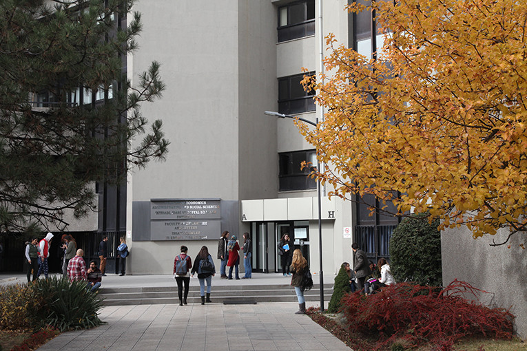

::: {.hero}
::: {.sec-inner .hero-grid}
::: {.hero-text}
[ · ]{.eyebrow}

# 

[We study how people read and understand one another, from inferring others’ traits, thoughts, and feelings to taking their perspective, and how these processes shape the way we judge and treat others.]{.lead}
:::

::: {.hero-photo}
{fig-alt="Bilkent University campus"}
:::
:::
:::

::: {.sec .sec-sand}
::: {.sec-inner}

## Interested in joining the lab? {.intro-heading}

::: {.join-grid}

::: {.join-card}
[Starting Spring 2027]{.card-tag}

### Undergraduate research assistants

We are looking for undergraduate research assistants to join the lab in Spring 2027! Research assistants help run studies, conduct literature reviews, code and manage data, and take part in lab meetings. If you are interested in gaining research experience and seeing how social psychology research is done from the inside, we would love to hear from you.

[Contact](mailto:mkezer@bilkent.edu.tr){.more-link}
:::

::: {.join-card}
[Starting Fall 2027]{.card-tag}

### Graduate students

The IPU lab will be accepting graduate students to start in Fall 2027. Students receive hands-on training in study designs, advanced statistical methods, and open-science practices, and are involved in every stage of the research process. If you are interested in how people perceive and understand one another, consider applying to the graduate program in the Department of Psychology at Bilkent University!

[Contact](mailto:mkezer@bilkent.edu.tr){.more-link}
:::

:::

:::
:::

